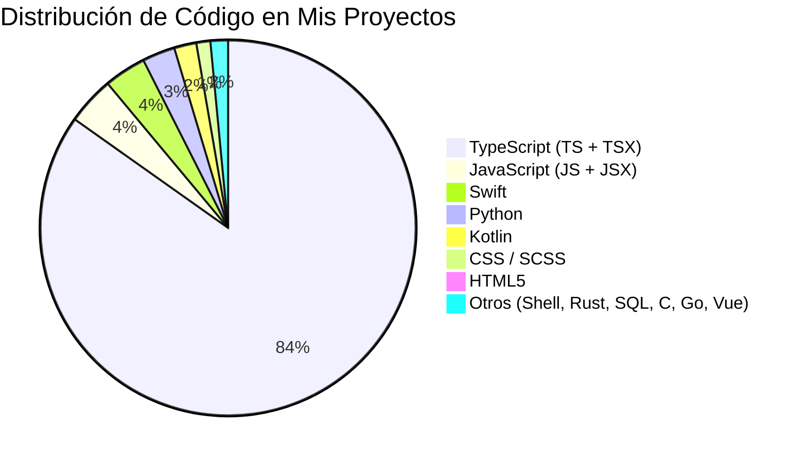

<div align="center">

# ⚡ Javier Ignacio Mujica
### **Founder • AI Orchestration Architect • Full-Stack Systems & Edge AI**

```
     _      _    __     __  ___   _____   ____       __  __ _   _     _ ___ ____    _    
    | |    / \   \ \   / / |_ _| | ____| |  _ \     |  \/  | | | |   | |_ _/ ___|  / \   
 _  | |   / _ \   \ \ / /   | |  |  _|   | |_) |    | |\/| | | | |   | || || |    / _ \  
| |_| |  / ___ \   \ V /    | |  | |___  |  _ <     | |  | | |_| | \_| || || |___/ ___ \ 
 \___/  /_/   \_\   \_/    |___| |_____| |_| \_\    |_|  |_|\___/ \___/|___|\____/_/   \_\
```

[](https://javiermujica.com)
[](https://verticapp.pro)
[](https://sintergiagroup.com)
[](https://javiermujica.com/deeplink/vibecode)
[](https://www.linkedin.com/in/javier-mujica-aa32291a/)
[](mailto:hola@javiermujica.com)

</div>

---

## ⚡ Perfil & Visión Técnica

> *"Arquitecto sistemas de software de alto rendimiento, enjambres de agentes autónomos y visión computacional en el borde. Mi motor diario es convertir complejidad técnica en plataformas escalables que resuelven problemas reales."*

Soy desarrollador senior y founder especializado en **ingeniería de software full-stack, automatización robótica (RPA) y arquitecturas multi-agente basadas en LLMs**. Diseño pipelines asíncronos y resilientes que integran el protocolo **MCP (Model Context Protocol)** con ecosistemas de mensajería, bases de datos vectoriales y backends de ultra-baja latencia.

Mi búsqueda constante de precisión y biomecánica (nutrida por años de práctica física, acrobacia y handstand) converge en mi mayor producto de software: **[VerticApp.pro](https://verticapp.pro)**, un SaaS pionero de inferencia neuronal on-device (<16ms) para corrección postural sagital en tiempo real. 

Además, formo a la próxima generación de constructores de tecnología en **Vibecode Lab**, un semillero de unicornios donde estructuramos squads de alto valor orientados a tracción, ventas y levantamiento de capital.

---

## 🚀 Proyectos Principales & Liderazgo

- 🦄 **[Vibecode Lab](https://www.javiermujica.com/deeplink/vibecode) (Founder & Lead Mentor):** El semillero que forma squads con los 4 arquetipos ideales para escalar rápido (*DEV, Founder, Creative, Just Graduated*). 7 semanas, 7 sprints, validación con pauta en vivo y Demo Day final con Pitch Deck probado en mercado. (hablen al bot 🎁) • (IG: [@mujica_ai_lab](https://instagram.com/mujica_ai_lab)).
- 🎯 **[VerticApp.pro](https://verticapp.pro) (Fundador & Lead AI Architect):** Plataforma SaaS de visión artificial en el navegador/móvil para análisis biomecánico de handstand y calistenia. Inferencia local con MediaPipe/TensorFlow.js, retroalimentación auditiva y 100% de privacidad de datos.
- 🏢 **[Sintergia Group](https://sintergiagroup.com) (Socio Tecnológico & Head of Engineering):** Plataforma y consultora de clima organizacional potenciada con IA. Elevamos la salud de los equipos integrando ciberseguridad, automatización y desarrollo de capacidad agéntica para transformar la dinámica laboral.
- 🌐 **[javiermujica.com](https://javiermujica.com):** Centro de servicios, consultoría y portafolio interactivo.
- 🤖 **Actualmente dominando:** **OpenClaw** y el desarrollo de servidores MCP personalizados para orquestar conversaciones y automatizaciones en WhatsApp y CRMs.
- 💬 **Ask me about:** **Agentic World**, enjambres autónomos (swarms), protocolos MCP, optimización de pipelines LLM, arquitecturas reactivas y visión computacional.

---

## 🎯 Proyectos, Iniciativas & Embudos

| Iniciativa / Proyecto | Enfoque & Propuesta de Valor | Enlace / Embudo |
|---|---|---|
| **Vibecode Lab** 🦄 | **Semillero de Unicornios.** Squads de 4 arquetipos (*DEV, Founder, Creative, Just Graduated*). 7 sprints, lenguaje común de build/launch/fundraising, testeo con pauta en vivo y pozo común. Próxima Gen: 25 Nov. | [Página del Curso](https://www.javiermujica.com/deeplink/vibecode) (hablen al bot 🎁) • [Detalle del Embudo](file:///home/astro/dev/portafolio/funnels/vibecode-lab/README.md) • IG: [@mujica_ai_lab](https://instagram.com/mujica_ai_lab) |
| **Sintergia Group** 🏢 | **Clima Organizacional & Capacidad Agéntica.** Diagnóstico y transformación de la cultura laboral, blindaje en ciberseguridad y habilitación de equipos con herramientas de IA agéntica y RPA corporativo. | [Embudo Sintergia](file:///home/astro/dev/portafolio/funnels/ai-agents-rpa/README.md) • [sintergiagroup.com](https://sintergiagroup.com) |
| **VerticApp.pro** 🎯 | SaaS de análisis biomecánico on-device (<16 ms) de handstand mediante visión computacional y privacidad local. | [VerticApp.pro](https://verticapp.pro) |
| **AcroTrain** 🤸 | Talleres presenciales de control postural, biomecánica sagital, handstand y movilidad viva. | [Embudo @acrotrain](file:///home/astro/dev/portafolio/funnels/handstand-acrotrain/README.md) |
| **Facilitación Vivencial** 🌿 | Encuentros de Biodanza, retiros somáticos y espacios vivenciales de servicio. | [Embudo @javieriignaciomujica](file:///home/astro/dev/portafolio/funnels/biodanza-retiros/README.md) |

---

### 📅 Ciclo de Masterclasses de Tracción (Pre-Lanzamiento Gen 2 Vibecode Lab)
- **9 Nov:** **MCP (Model Context Protocol)** – Conectando tu IA al mundo real: herramientas, contexto y ejecución de APIs.
- **16 Nov:** **OpenClaw** – Orquestación de agentes autónomos: flujos complejos y automatización operativa.
- **23 Nov:** **Tracción** – Hackathon express y test de mercado real: landing, *vibe coding* y pauta en vivo con pozo común.
- **25 Nov:** **🚀 Despegue Oficial Gen 2** (7 semanas, 7 sprints, 4 arquetipos, 1 pitch deck).

---

## 📊 Radiografía Cuantitativa del Código

Medición estática propia sobre **49 repositorios** y **~61.6 K archivos fuente**: **14.31 M líneas de código**, excluyendo `node_modules`, artefactos de build y binarios (porcentajes sobre líneas de código; JSON/YAML/Markdown fuera del cálculo).

```
TypeScript          ████████████████████████████████ 78.9%  ·  11.29 M líneas
TSX (React)         ██ 5.3%  ·  762 K
Swift               █ 3.6%  ·  514 K
JavaScript          █ 3.5%  ·  499 K
Python              █ 2.8%  ·  393 K
Kotlin              ▏1.9%  ·  278 K
CSS / SCSS          ▏1.2%  ·  169 K
JSX (React)         ▏0.7%  ·   93 K
HTML5               ▏0.6%  ·   88 K
Shell / Bash        ▏0.5%  ·   73 K
Rust                ▏0.5%  ·   64 K
SQL                 ▏0.2%  ·   31 K
C / Go / Vue / Java ▏0.3%  ·   41 K
```



**🔍 Herramientas verificadas en el entorno (por repositorio):**
- **Frontend:** React (26), Next.js (17), Vite (15), Tailwind CSS (20), Radix UI, Lucide (19), React Hook Form (11), Zod, Vue, Astro.
- **Backend & Data:** Node.js, Express (10), Fastify, WebSockets (`ws`), Supabase (15), Prisma, PostgreSQL, SQL nativo.
- **Nativo & IA:** Swift/SwiftUI (1.841 archivos), Kotlin (804), Python (Pydantic, NumPy, NetworkX, PyArrow, OpenCV, MediaPipe).
- **Infra & Calidad:** Docker/Compose (15), Vercel, PM2, ESLint, Prettier, `tsc`, Git.

---

## 🛠️ Stack Tecnológico por Relevancia e Impacto

| Dominio | Tecnologías y Herramientas |
|---|---|
| **IA Agéntica & Visión** | Python, OpenCV, MediaPipe, TensorFlow.js, MCP (Model Context Protocol), OpenClaw, LangChain, SDKs (Claude, Gemini, DeepSeek) |
| **Frontend & UX** | React 19, Next.js 15 (App Router), TypeScript, Tailwind CSS, Vite, Vue 3, Canvas API, Web Audio API |
| **Backend & RPA** | Node.js, Fastify, Express, Python (FastAPI), Baileys (WhatsApp Automations), Headless Browsers, REST APIs |
| **Cloud & Persistencia** | PostgreSQL, Supabase (Auth, RLS, Storage), MongoDB, Vercel Edge, GCP, Docker, PM2 |

---

## 📄 Trayectoria & Experiencia

- 🇪🇸 **Currículum Vitae (Español):** [Ver CV en javiermujica.com](https://javiermujica.com) *(o en [Google Drive](https://drive.google.com/file/d/16riqF6xJSbEgH1aq4TAuJsks4WGVeOXb/view?usp=sharing))*
- 🇬🇧 **Resume (English Version):** [English Resume (Web/PDF)](https://javiermujica.com/resume-en)

---

## 📬 Conectemos

<div align="left">

- 🌐 **Web:** [javiermujica.com](https://javiermujica.com)
- 📧 **Email:** [hola@javiermujica.com](mailto:hola@javiermujica.com)
- 💼 **LinkedIn:** [linkedin.com/in/javier-mujica-aa32291a](https://www.linkedin.com/in/javier-mujica-aa32291a/)
- 🐙 **GitHub:** [@AiesTreiA](https://github.com/AiesTreiA) / [@jamujica6](https://github.com/jamujica6)
- 🦄 **Instagram Coder / AI Lab:** [@mujica_ai_lab](https://instagram.com/mujica_ai_lab)
- 🤸 **Instagram Movimiento:** [@acrotrain](https://instagram.com/acrotrain)
- 🌿 **Instagram Vivencial:** [@javieriignaciomujica](https://instagram.com/javieriignaciomujica)

</div>
